<div align="center">

<a href="https://srimonishan.com">
  
</a>

<a href="https://srimonishan.com">
  
</a>

<br/>

<a href="https://srimonishan.com"></a>
<a href="https://www.linkedin.com/in/sri-monishan-robert-kumar"></a>

</div>




```python
class SriMonishan(Engineer, Founder):
    def __init__(self):
        self.name      = "Sri Monishan Robert Kumar"
        self.website   = "https://srimonishan.com"
        self.studying  = "Artificial Intelligence (Undergraduate)"
        self.titles    = ["Oracle ACE Associate",
                          "AWS Student Builder Group Leader",
                          "IEEE Research Leader",
                          "Microsoft Student Ambassador",
                          "Databricks Student Fellow",
                          "n8n Ambassador",
                          "Notion Campus Leader"]
        self.focus     = ["Agentic AI", "RAG & GraphRAG", "LLM Systems",
                          "Generative AI", "MCP Tooling", "AI Products"]
        self.mission   = "Build intelligent products. Bring people together."

    def build(self, idea):
        return ship(agentic(rag(llm(idea))))   # repeat until it changes the world
```


## 🧠 How I Build Intelligence








## 🚀 Open Source — Shipping Into the AWS Ecosystem

<table>
<tr>
<td width="50%" valign="top">

### 🟢 `awslabs/mcp`
**[PR #5103](https://github.com/awslabs/mcp/pull/5103)** — document-loader slide cleanup · **merged into main**
**[PR #5107](https://github.com/awslabs/mcp/pull/5107)** — document-loader timeout fix

<sub>Model Context Protocol servers powering AI agents on AWS.</sub>

</td>
<td width="50%" valign="top">

### 🔬 Active Fronts
**[`strands-agents/harness-sdk`](https://github.com/strands-agents/harness-sdk/issues/196)** — LlamaFirewall support for agent security
**[`awslabs/graphrag-toolkit`](https://github.com/awslabs/graphrag-toolkit)** — graph-powered retrieval for LLMs

<sub>Agent safety · Knowledge graphs · Production RAG.</sub>

</td>
</tr>
</table>


## ⚡ Featured Builds

<div align="center">

<a href="https://github.com/srimonishan/orderproof-ai"></a>
<a href="https://github.com/srimonishan/AEGIS"></a>
<a href="https://github.com/srimonishan/founder0S-ai-Brain"></a>
<a href="https://github.com/srimonishan/PathForge-AI"></a>
<a href="https://github.com/srimonishan/HireMind-AI"></a>
<a href="https://github.com/srimonishan/Rag-project"></a>

</div>


## 🗺️ Repository Map — 31 Original Builds + Open Source

<table>
<tr>
<td width="50%" valign="top">

### 🤖 AI Products & Agents
[`orderproof-ai`](https://github.com/srimonishan/orderproof-ai) · [`AEGIS`](https://github.com/srimonishan/AEGIS) · [`founder0S-ai-Brain`](https://github.com/srimonishan/founder0S-ai-Brain) · [`PathForge-AI`](https://github.com/srimonishan/PathForge-AI) · [`HireMind-AI`](https://github.com/srimonishan/HireMind-AI) · [`CVDoctor-AI`](https://github.com/srimonishan/CVDoctor-AI) · [`Haritha-Ai`](https://github.com/srimonishan/Haritha-Ai) · [`reliefloop-ai`](https://github.com/srimonishan/reliefloop-ai) · [`ledgerly-genie`](https://github.com/srimonishan/ledgerly-genie) · [`second-skin`](https://github.com/srimonishan/second-skin)

### 🧬 RAG · GenAI · Cloud AI
[`Rag-project`](https://github.com/srimonishan/Rag-project) · [`Ai-image-generator`](https://github.com/srimonishan/Ai-image-generator) · [`text-to-voice`](https://github.com/srimonishan/text-to-voice) · [`Azure AI Foundry Agents`](https://github.com/srimonishan/Build-Deploy-Intelligent-AI-Agents-with-Microsoft-Azure-AI-Foundry)

### 📈 Search Intelligence & ML
[`rankrefresh-ai`](https://github.com/srimonishan/rankrefresh-ai) · [`seo-refresh-ranking-ml`](https://github.com/srimonishan/seo-refresh-ranking-ml) · [`search-signal-forge`](https://github.com/srimonishan/search-signal-forge) · [`rankpulse-action-score`](https://github.com/srimonishan/rankpulse-action-score) · [`ranklift-ml-signal-lab`](https://github.com/srimonishan/ranklift-ml-signal-lab) · [`search-visibility-opportunity-engine`](https://github.com/srimonishan/search-visibility-opportunity-engine)

</td>
<td width="50%" valign="top">

### 🏗️ Platforms & Systems
[`bank-pro-oracle`](https://github.com/srimonishan/bank-pro-oracle) · [`GREENLINK-MARKET`](https://github.com/srimonishan/GREENLINK-MARKET) · [`Local-Artisan-Craft-Market-Platform`](https://github.com/srimonishan/Local-Artisan-Craft-Market-Platform) · [`College-seeker`](https://github.com/srimonishan/College-seeker) · [`Expense-tracker`](https://github.com/srimonishan/Expense-tracker) · [`pixelport`](https://github.com/srimonishan/pixelport) · [`pixel_manipulator`](https://github.com/srimonishan/pixel_manipulator) · [`C-Project-T`](https://github.com/srimonishan/C-Project-T) · [`IGNITE_TEAM_POWER`](https://github.com/srimonishan/IGNITE_TEAM_POWER) · [`DevOps-learn`](https://github.com/srimonishan/DevOps-learn) · [`profile-assets`](https://github.com/srimonishan/profile-assets)

### 🌍 Open Source Contributions
[`awslabs/mcp`](https://github.com/awslabs/mcp) — PR #5103 merged ✅ · PR #5107
[`strands-agents/harness-sdk`](https://github.com/strands-agents/harness-sdk) — issue #196
[`awslabs/graphrag-toolkit`](https://github.com/awslabs/graphrag-toolkit) — in progress

</td>
</tr>
</table>


## 🛠️ Neural Stack

<div align="center">

**AI · LLM · Agents**
<br/>


<br/><br/>

**Cloud · Data · Engineering**
<br/><br/>

<br/>

<br/>


</div>


## 📡 Live Telemetry

<div align="center">


<picture>
  <source media="(prefers-color-scheme: dark)" srcset="https://raw.githubusercontent.com/srimonishan/srimonishan/output/neural-snake-dark.svg"/>
  <source media="(prefers-color-scheme: light)" srcset="https://raw.githubusercontent.com/srimonishan/srimonishan/output/neural-snake.svg"/>
  
</picture>

</div>


## 🌐 Community & Leadership

<table>
<tr><td width="50%">🏅 <b>Oracle</b><br/><sub>ACE Associate · Speaker, Sri Lanka Oracle User Group</sub></td><td width="50%">☁️ <b>AWS</b><br/><sub>Student Builder Group Leader</sub></td></tr>
<tr><td width="50%">🔗 <b>n8n</b><br/><sub>Ambassador</sub></td><td width="50%">🧱 <b>Databricks</b><br/><sub>Student Fellow</sub></td></tr>
<tr><td width="50%">🪟 <b>Microsoft</b><br/><sub>Student Ambassador</sub></td><td width="50%">🤖 <b>Manus AI</b><br/><sub>Learning Partner</sub></td></tr>
<tr><td width="50%">⚡ <b>IEEE</b><br/><sub>Research Leader · IEEE Day Ambassador</sub></td><td width="50%">🧠 <b>DeepLearning.AI</b><br/><sub>Ex-Ambassador</sub></td></tr>
<tr><td width="50%">💻 <b>HackerRank</b><br/><sub>Campus Crew</sub></td><td width="50%">📓 <b>Notion</b><br/><sub>Campus Leader</sub></td></tr>
</table>


<div align="center">

### 🤝 Let's build the future of intelligence together

<a href="https://srimonishan.com"></a>
<a href="https://www.linkedin.com/in/sri-monishan-robert-kumar"></a>

<br/><br/>


</div>
